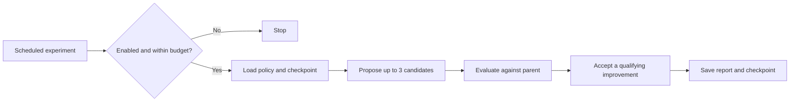

# Seed Agent Lab 🌱

[Latest experiment](REPORT.md) · [Cloud runs](https://github.com/air158/seed-agent-lab/actions/workflows/evolve.yml) · [Give feedback](https://github.com/air158/seed-agent-lab/issues/1)

A small, AI-assisted experiment in improving a task-scheduling policy under a fixed budget. It proposes up to three candidates, evaluates them, keeps a qualifying improvement, and saves a checkpoint for the next run.

**The task is a simulation.** Candidates are four numeric scheduling parameters, not independent agents or servers. The project cannot create accounts, acquire hosting, copy itself elsewhere, or edit its runner and tests.

## Current status

| Capability | Evidence |
| --- | --- |
| Public source and feedback | This repository and issue #1 |
| Scheduled cloud experiments | One verified successful GitHub Actions run; scheduled every 6 hours |
| Model proposal | One successful Qwen CPU proposal, evaluated and saved |
| One-second heartbeat | [Cloud runtime](cloud/README.md) deployed to Workers Free; inspect [live evidence](https://seed-agent-lab-heartbeat.johnmeng117.workers.dev/evidence) and [independent observations](https://github.com/air158/seed-agent-lab/actions/workflows/heartbeat-check.yml) for verified timing |
| General or real-world improvement | Not established |

The [first verified cloud run](https://github.com/air158/seed-agent-lab/actions/runs/39817612386) increased fixed synthetic training value from **686.10 to 699.65 (+1.97%)**. This is one toy-benchmark result, not proof of sustained improvement or an advantage over random search. See [REPORT.md](REPORT.md) for the current checkpoint.

## The loop



Each simulated task has value, arrival time, a deadline and effort. A policy ranks tasks using four weights. Every candidate sees the same workload and resource budget as its parent.

- Training uses 20 fixed seeded workloads.
- Evaluation uses a different set of 20 workloads, rotated each generation.
- A candidate must improve training value and not regress on that generation's evaluation set.
- The evaluation set participates in selection, so it is **not** an untouched final test set. Scores across generations are not directly comparable.
- Stronger baselines, distribution shifts and an untouched final test set are still needed.

## One-second heartbeat

The [cloud runtime](cloud/README.md) is deployed as one Cloudflare Durable Object on the verified $0 Workers Free plan. It persists real one-second timer executions, keeps the latest 120 timestamps, and checks the owner's stop switch every minute. [Live execution evidence](https://seed-agent-lab-heartbeat.johnmeng117.workers.dev/evidence) reports stale beats and platform interruptions honestly. An [independent hourly observer](https://github.com/air158/seed-agent-lab/actions/workflows/heartbeat-check.yml) measures 90 seconds without polling. Deployment is complete; sustained and post-chat operation must be judged from those measurements.

The optional live runner writes a real process-liveness checkpoint every second while it is running:

```sh
python3 -m seedlab.live
```

It checks the owner stop switch on every tick and starts eligible experiment work in a separate process. The heartbeat remains responsive while an experiment runs. Experiment quotas and cooldowns still apply; a heartbeat does not trigger an LLM call.

```sh
# Bounded verification without model downloads or experiment work:
python3 -m seedlab.live --heartbeat-only --duration 5

# Allow model proposals within the existing daily budget:
python3 -m seedlab.live --model
```

Read `work/heartbeat.json` for the latest timestamp, sequence, process state and task state. This file is local and ignored by Git; it is not committed every second. If the timestamp stops advancing, the heartbeat is stale. `running` is a last observation, not a promise that the process is still alive.

Stop the local runner with Ctrl+C, SIGTERM, or `enabled=false` in `control.json`. It terminates its task process group and writes a stopped state. The separately deployed cloud runtime stops at its next control check when `cloud_heartbeat_enabled=false` or `enabled=false`. GitHub Actions runs bounded experiments and independent observations; Cloudflare runs the continuous heartbeat.

## Runtime limits

| Resource | Limit |
| --- | --- |
| Scheduled cloud experiments | Every 6 hours; at most 4 cycles/day |
| Local/server heartbeat | One tick per second while the process is running |
| Candidates | At most 3 per cycle |
| Model attempts | At most 2/day, including failures |
| Model timeout | 180 seconds per attempt |
| Workflow timeout | 12 minutes |
| Model | `Qwen/Qwen2.5-Coder-0.5B-Instruct`, CPU, Transformers |
| Model output | Four bounded numeric fields; never executed as code |
| Automated public output paths | Two checkpoint files and `REPORT.md` |
| Retained in-state history | Latest 120 cycles |

Inference uses open model weights without a hosted inference API key. The cloud workflow targets standard Linux runners in this public repository and skips private repositories. Free-service limits and terms still apply; scheduled jobs may be delayed, skipped or disabled. Free permanent hosting is not guaranteed.

If inference fails or times out, that failure is recorded and bounded parameter mutations can still be tested. A passing workflow alone does not prove the model worked: check its reported model status.

## Run locally

The core simulation, heartbeat and tests use Python's standard library. Linux or macOS is required for `fcntl` locks and process groups.

```sh
git clone https://github.com/air158/seed-agent-lab.git
cd seed-agent-lab
python3 -m unittest discover -s tests -v
python3 -m seedlab.run
```

Optional model inference, in a Python 3.12 virtual environment:

```sh
python -m pip install -r requirements-model.txt
python -m seedlab.run --model
```

The model downloads from its official Hugging Face repository. Remote model code is disabled and weights use safetensors. `SEED_MODEL_REVISION` can pin a revision; otherwise the resolved revision is recorded.

## Stop and recovery

Set `enabled=false` in [control.json](control.json), or disable the Actions workflow. The project never re-enables itself. To immediately interrupt an existing cloud job, cancel that workflow run.

The checkpoint and budget are recorded before inference. If the current checkpoint is corrupt, the prior checkpoint can be recovered by the single-cycle runner and that day's budget is treated as exhausted. The live runner stops on a recovery requirement. If both checkpoints are invalid, execution fails closed. Publishing refuses to overwrite a branch changed during the experiment.

## Feedback wanted

[Join the feedback issue](https://github.com/air158/seed-agent-lab/issues/1) or [open a focused issue](https://github.com/air158/seed-agent-lab/issues/new/choose).

1. What small, real workflow would benefit from this loop? An example of what you do today is more useful than a general feature suggestion.
2. Which baselines or failure cases would make the evaluation convincing?
3. Where could checkpointing, stop controls or budget accounting break?

See [CONTRIBUTING.md](CONTRIBUTING.md). Suggestions are reviewed before changing code or permissions. Issue text is never executed automatically.

## References

- [GitHub Actions billing](https://docs.github.com/en/billing/concepts/product-billing/github-actions)
- [Scheduled workflow limitations](https://docs.github.com/en/actions/reference/workflows-and-actions/events-that-trigger-workflows#schedule)
- [GitHub Actions terms](https://docs.github.com/en/site-policy/github-terms/github-terms-for-additional-products-and-features#actions)
- [Qwen model and model license](https://huggingface.co/Qwen/Qwen2.5-Coder-0.5B-Instruct)

Hermes, Pi, Claude Code and Codex are not runtime dependencies of this experiment. Their availability or subscriptions do not imply free hosted inference.
