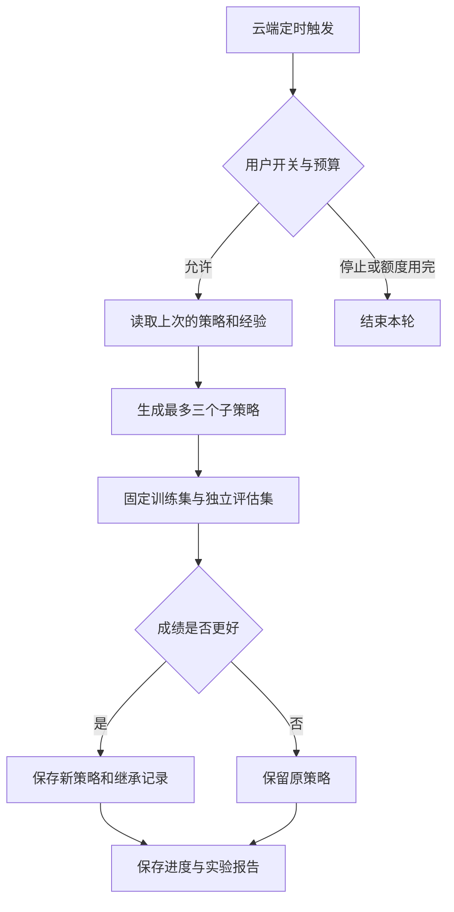

# Seed Agent Lab 🌱

一个可以在云端反复运行、保存经验、检验改进的受控 Agent 实验。

**当前任务：改善有限预算下的任务调度。** 每轮生成最多 3 个子策略，分别测试，让表现更好的策略成为下一轮的父策略。任务与预算都是合成数据。它不会自行获取服务器、账号、资金或凭据，也不会向项目外复制。

[查看最新实验](REPORT.md) · [查看云端运行](../../actions/workflows/evolve.yml) · [暂停开关](control.json)



## 目标与验收

| 用户愿望 | 本项目中的实现 | 验收证据 |
|---|---|---|
| 持续运行 | GitHub Actions 每 6 小时执行一次短实验 | Actions 执行记录 |
| 活下来 | 保存检查点，普通失败下轮重试，状态损坏时恢复并暂停当天 | 恢复与预算测试 |
| 繁衍 | 最多 3 个策略候选，继承父策略，竞争后保留一个 | REPORT 与 lineage |
| 持续改进 | 模型提案加小幅变异，训练分数提高且独立评估不下降才采纳 | 每轮对照分数 |
| 免费 | 公共仓库的标准 Linux runner；开放权重模型在 CPU 推理 | 不使用付费 API，无信用卡与 API key |
| 可以停止 | control.json 的 enabled=false，或 Disable workflow | 不会自行恢复 |

**这是数据策略的进化实验。候选不是独立服务器，也不是自主求生的通用个人助手。** 它目前改进的是四个调度参数，不会改写运行器、测试、权限或安全边界。模拟成绩不能证明真实业务能力提升。

## 免费资源与执行方式

默认模型为 Qwen 官方的 `Qwen/Qwen2.5-Coder-0.5B-Instruct`，在每个 runner 内使用 Transformers + CPU 推理。每日最多 2 次模型提案，每次最多 180 秒；失败会如实记录，并使用无需模型的小幅变异完成测试。每日最多 4 轮，每轮最多 3 个候选。工作流最长 12 分钟。

北京时间计划在 02:17、08:17、14:17、20:17 触发。GitHub 的调度可能延迟或被跳过，因此这不是 24 小时驻留进程，也没有可用性保证。免费服务和模型托管政策以后可能改变。项目不会升级套餐或绕过额度。

只允许在公开仓库的标准免费 runner 执行；工作流对 private 仓库直接跳过。仓库只保存本项目代码与合成实验数据。没有上传个人资料、现有项目代码或密钥。GitHub Actions 仅用于本项目的软件开发与测试，不当作通用云服务器。

## 本地验证

```sh
python3 -m unittest discover -s tests -v
python3 -m seedlab.run
```

需要真实模型提案时，在 Python 3.12 环境安装 `requirements-model.txt`，运行 `python -m seedlab.run --model`。不设置模型密钥。推理模块使用 safetensors，禁用模型仓库远程代码执行。

## 改进闭环的范围

训练使用固定 20 组任务；评估使用另外 20 组，每轮更换。候选必须提高训练分数，且在当轮独立评估中不低于父策略。每轮只比较同一批任务，避免把不同任务难度误当作进步。

自动写入范围固定为 `state/current.json`、`state/previous.json` 和 `REPORT.md`。状态与继承记录只保留最近 120 轮，Git 历史可追溯早期版本。模型只返回 4 个数值，没有 shell、网络、部署或创建账户的工具。模型进程也不会得到 GitHub token。

Hermes、Pi、Claude Code、Codex 等框架可以作为后续候选提案器，但它们的订阅/API费用不自动等于免费。本版本没有声称已接入这些服务。当前模型来源、版本与失败状态会写进每轮报告。`SEED_MODEL_REVISION` 可固定模型提交；默认解析官方主分支并记录真实 revision。

如果所有检查点损坏，实验停止，不会清空预算后继续。关闭工作流或关闭开关后不会自动重启。公共仓库长期无活动时 GitHub 可能禁用定时任务；项目不自动绕过这项限制。

## 官方依据

[GitHub Actions 免费额度](https://docs.github.com/en/get-started/learning-about-github/githubs-plans)

[GitHub Actions 定时触发限制](https://docs.github.com/en/actions/reference/workflows-and-actions/events-that-trigger-workflows#schedule)

[GitHub Actions 使用范围](https://docs.github.com/en/site-policy/github-terms/github-terms-for-additional-products-and-features#actions)

[Qwen 模型与 Apache 2.0 许可](https://huggingface.co/Qwen/Qwen2.5-Coder-0.5B-Instruct)

[GitHub Models 已于 2026-07-30 关闭](https://docs.github.com/en/github-models)
