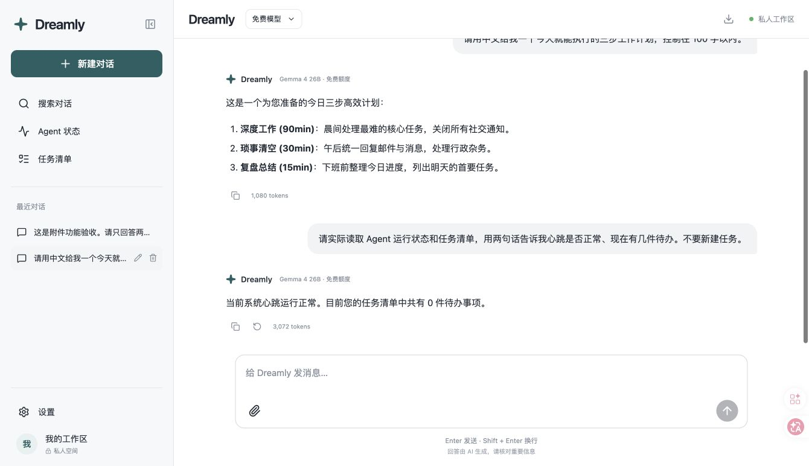
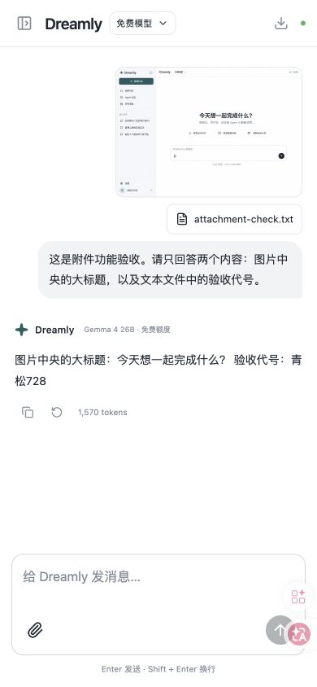

# Dreamly free chat deployment verification

Verified October 23, 2026 (Asia/Shanghai). Application code revision: `1803a41`; heartbeat resumed by `9177d1a`. This record completes the production verification that was still pending in the design ledger at the application revision.

## Running service

- URL: https://seed-agent-lab-heartbeat.johnmeng117.workers.dev/
- Provider: native Cloudflare Workers AI binding; `@cf/google/gemma-4-26b-a4b-it`.
- Dashboard confirmed **Workers Free** as the current plan. No upgrade or prepaid credits were used. The free allocation is shared across the account: 10,000 Neurons/day, resetting at 00:00 UTC. Requests fail on the free plan after that allowance is exhausted. The application also limits model calls to 50/day and has no automatic paid-provider fallback.
- The only runtime secret added was `WORKSPACE_LOGIN_HASH`, shown as **Value encrypted**. No MomoAI API key was uploaded. Access code and local settings are excluded from Git.

## Observed results

- The public root returned the actual chat HTML. `/api/session` reported ready and unauthenticated; unauthenticated `/api/chats` returned HTTP 401.
- Browser login succeeded. A real free-model response returned a three-step Chinese work plan.
- A following message actually invoked `get_agent_status` and `list_tasks`. Saved tool metadata reported both successful; the completed answer correctly reported a healthy heartbeat and zero tasks.
- A generated public UI concept image and a synthetic text fixture were attached through the file picker. The real model correctly read both the image headline and the fixture's verification phrase.
- Reload restored the selected conversation and its messages. At 390×844, document width was 390 with no horizontal overflow. This is browser viewport testing, not a physical phone test. Viewport override was reset afterwards.
- The earlier local adapter verification also exercised stop/partial persistence and task creation/readback. The final free provider is separately covered by tests for streamed text, fragmented tool calls, vision conversion, quota errors, truncated streams, and no paid-key use.
- All 13 unit tests, private-workspace integration tests, GitHub cloud-runtime checks and Cloudflare build completed successfully. Credential-value scan found zero matches in 69 repository/build files.

## Heartbeat continuity boundary

The existing heartbeat was intentionally paused for the runtime update and then resumed. The pause remains visible in recorded gap history. After restoration, a fresh 30-second interval with zero polling observed 31 individual beats, 1,000 ms p95, 1,001 ms maximum interval, no new gap, and no restart. [Raw observation](dreamly-heartbeat-after-chat-2026-10-23.json). This is a bounded verification interval, not an uptime guarantee.

## Screenshots

## Scope and privacy

Saved chats, Markdown, streaming/stop, regeneration, search, export, attachments, settings, reminders, and real Agent status/report access are implemented. Task reminders do not automatically execute external work. The app has no arbitrary web-search, shell, email or deployment tools. Cloudflare hosts both chat storage and model processing; this is not end-to-end encrypted storage. Model accuracy and future availability are not guaranteed.

Sources: [Workers AI pricing](https://developers.cloudflare.com/workers-ai/platform/pricing/), [Gemma model capabilities](https://developers.cloudflare.com/workers-ai/models/gemma-4-26b-a4b-it/).
